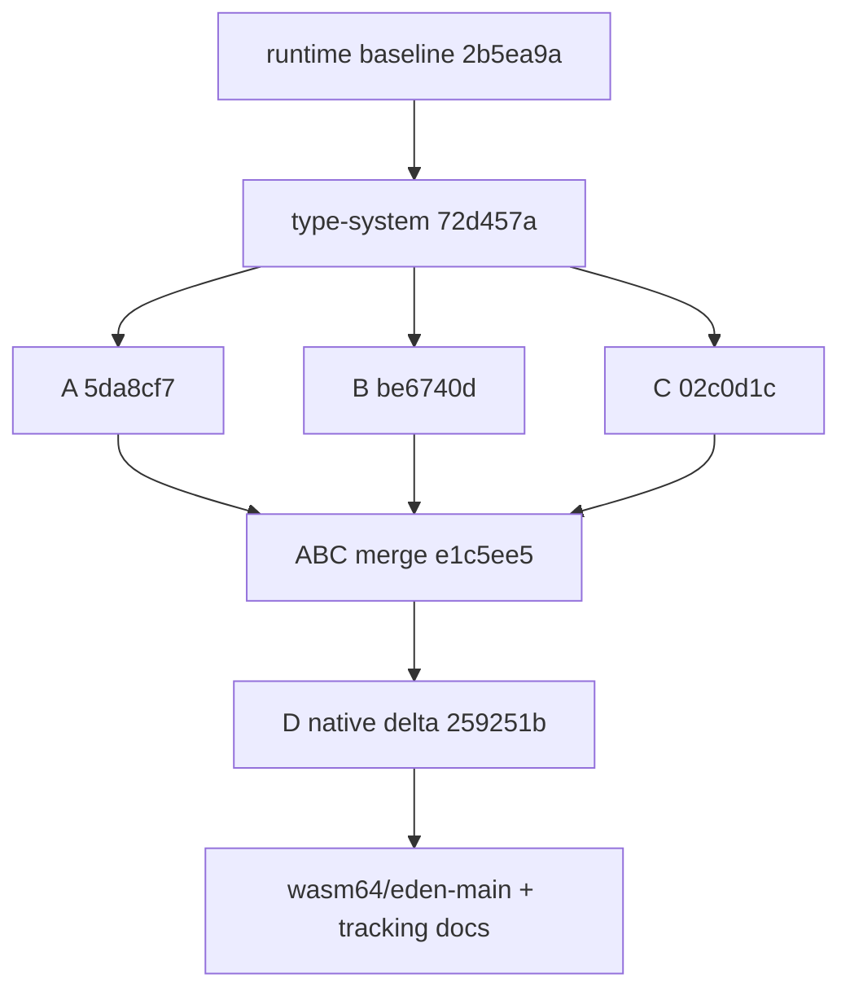

# 分支、review 与后续执行流程

## 当前拓扑

A/B/C 是相对共同基线的独立变更；D 依赖三者。D 原生 review 范围为
`e1c5ee5b490f132acc22e02d57c03b1b66dfbafd..259251bb79268a221f0019edd1ad9d384fa1a3c3`。
不能将 D 相对 upstream main 的完整累积 diff 描述成“只有 native delta”。

| 范围 | 主要代码 | 直接依赖 |
| --- | --- | --- |
| A | root/eng target routing、CoreLib csproj/shared props、AsmOffsets | type-system 基线；无 LLVM |
| B | Common calling convention/ISA、Crossgen2、portable generators 与生成入口 | 基线；生成需要匹配的 CoreLib/framework inputs，无 LLVM fix |
| C | `eng/wasm/BuildMemory64Icu.proj`、`Memory64Icu.props`、`build-memory64-icu.py` | 原 SDK 与 ICU source；无 LLVM fix |
| D | native CMake/build、PAL/VM/GC/contexts、`.S`、三份 canonical64 helper 表、corerun/kit/依赖 hooks | A+B+C；table64 assembler fix |

## 每个 checkpoint 的流程

1. 固定 upstream、feature base/head、工具链及 SDK revision。先检查工作树和已有可用 baseline。
2. 根据 roadmap 选最小可独立审查的行为，声明 producer/consumer 共同合同及真实依赖。
3. 实现与适用现有测试矩阵同步；不得重新引入已删除的 wasm64 专项测试框架。
4. 先验证 wasm32 对照，再验证当前支持的 wasm64 lane；编译/Module/执行分别记结果。
5. 将结果摘要、命令、输入 SHA、数量和限制加入 evidence，更新 status/roadmap/decisions。
6. 汇合固定且已完成当前门槛的 feature tip 到 eden-main。共享语义的修复归 owning feature，而非长期只留集成分支。
7. 用户 review 后按依赖顺序准备 upstream PR；每个 PR 说明具体行为、验证和未支持项。集成分支不直接作为总 PR。

若 feature rebase/amend，更新精确 SHA 与 D/eden-main 中的依赖 checkpoint，核对生产 blobs；旧结果继续绑定旧 SHA，不把历史 PASS 自动改写为新 SHA 的全新运行。后续独立更新 upstream 时重建必要 baseline。

## 下一轮可执行工作

1. 用户先 review A（10 文件），再 review B（19 文件）、C（4 文件）、D 原生增量（40 文件）。当前尚未确认这些 PR 已上游合并。
2. 工具链：构建含用户 `8620eb7` 的正常 Clang/SDK，用产品默认 assembler 路径构建 D；明确与已有 MC backport 结果比较，不引入 suppression。
3. 核对并补齐现有 runtime runner/CORE_ROOT 的目标路由，然后执行最小 interpreter guest；不得假定当前 `src/tests/run.sh -arch wasm64` 已能工作。
4. 从上述接口 checkpoint 推进 managed ABI / GC / browser-loader。ABI 的 signatures、managed lowering、native consumer 与保存上下文需要共同检查。
5. 普通浏览器解释器、高地址与 GC gate 就绪后，逐步推进 JS、JIT/R2R、SDK 和现有 CI 矩阵。

正常 Clang 验证是后续验证工作，不阻止独立 review A/B/C。对 D，拥有正确 assembler 即可解除当前构建阻塞；不要求 LLVM 修复必须先被官方合并。

## 结果文件约定

新增记录放在 `evidence/<checkpoint-or-date>/`；大体积 binlog/二进制放 artifact store，并记录可访问位置、SHA256 与保存策略。勿提交凭据环境。记录完整命令及明确选择的环境变量即可。
结果模板见 [validation.md](validation.md)。本次文档归档只检查文档、JSON、校验和及生产树一致性，不重跑 native 产品构建。
